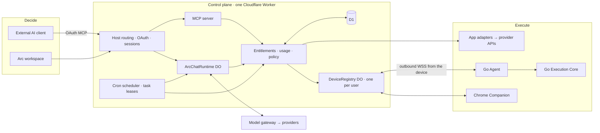

# Remote Arc architecture

Updated 2026-10-30 against `master`. **This file is the entry point for anyone,
human or agent, starting work in this repository.** Read it before changing
code. Deeper design contracts are linked at the end.

> Keep it current. When a change adds or moves a component, request path, data
> store, host, release step or contributor rule described here, update this file
> and the website architecture section (`apps/ui/src/features/docs/docs-system-overview.tsx`)
> in the same PR. `pnpm docs:architecture:check` fails CI when the facts it can
> verify (tool count, plan IDs, hosts, workflow name) drift from the source.

## What Remote Arc is

Remote Arc is not remote-desktop software, and it is more than an MCP server.
It is infrastructure that turns AI decisions into authorized, traceable actions
on a user's cloud accounts and computers.

The model decides what to do next. Remote Arc owns everything around that
decision: who is allowed to act, which account or computer receives the action,
which checks run before it executes, what is recorded, what persists after the
chat ends, and what it costs.

There are two ways in, and they share one execution layer:

- **Arc** is the hosted workspace. Arc runs its own configured models, with Credits.
- **Connect** lets the user's own AI client (ChatGPT, Claude, Codex, Cursor or
  any MCP client) use the same Apps, devices and browser tools over OAuth MCP.

## System at a glance



Nothing connects inbound to a user's computer. Devices and the browser
extension open authenticated outbound WebSockets to their owner's Durable Object.

## Components

| Component | Path | Runtime | Responsibility |
| --- | --- | --- | --- |
| Relay | `apps/relay` | Cloudflare Worker (`src/index.ts`) | Every hosted surface: website and dashboard assets, auth, OAuth, MCP, Arc runtime, Apps, Tasks, billing, admin APIs, crons |
| Dashboard and website | `apps/ui` | React + Vite, served as Worker static assets | Website, docs, Arc and Connect dashboards, checkout, admin console |
| Go Agent | `apps/agent` | Native binary `remotelink` | Pairing, relay session, background recovery, journals, task browser, local MCP setup for Claude/Codex |
| Go Execution Core | `packages/execution-core` | Go module compiled into the Agent | File and process tools, path policy, Safety Guard, Local Undo |
| CLI launcher | `packages/cli` | npm `remotelink` | Downloads and SHA-verifies the Go binary, then starts it |
| Browser Companion | `apps/browser-extension` | Chrome MV3 | Shared tabs and allowed sites in the user's own browser |
| Protocol | `packages/protocol` | Shared TS | Wire types, plan defaults (`ARC_PLANS`), features, published limits |
| Skills | `skills/`, `packages/skills` | Markdown + generated catalog | First-party and community Skills (for example `safe-cleanup`) |
| Docs data | `packages/docs` | Generated JSON + TS | Docs catalog and the generated tool index used by the website |
| MCP integration tests | `apps/mcp` | Node, test only | Runs the official MCP client against the Go Agent's local MCP server |

### Relay map (`apps/relay/src`)

`index.ts` is the Worker entry. Every other module lives in one domain folder.

| Area | Folder | Main files |
| --- | --- | --- |
| Worker entry | `src/` | `index.ts` |
| Hosts and shared infrastructure | `src/platform/` | `host-routing.ts`, `security.ts`, `d1-read-retry.ts` |
| Sign-in, sessions and OAuth | `src/auth/` | `auth.ts`, `email-auth.ts`, `dashboard-origin.ts`, `oauth.ts` |
| MCP server and tool surfaces | `src/mcp/` | `mcp.ts`, `mcp-edge-guard.ts`, `mcp-errors.ts`, `mcp-client-profile.ts`, `browser-runner-mcp.ts`, `shared-tab-mcp.ts`, `mcp-app-actions.ts` |
| Devices and files | `src/devices/` | `device.ts` (pairing, limits), `registry.ts` (`DeviceRegistry` DO), `device-call.ts`, `call-timeout.ts` (foreground reply budget), `fleet-scheduler.ts`, `file-resources.ts` |
| Browser authentication and Runner | `src/browser/` | `browser-auth.ts`, `runner-attention.ts` |
| Tasks, goals and crons | `src/tasks/` | `automations.ts`, `automation-store.ts`, `source-goals.ts`, `planned-goal-runtime.ts`, `task-events.ts`, `task-scheduler.ts` |
| Arc runtime, plans and credits | `src/arc/` | `arc-chat-object.ts` (`ArcChatRuntime` DO), `arc-chat-runtime.ts`, `arc-dispatcher.ts`, `model-gateway.ts`, `arc-memory.ts`, `arc-teams.ts`, `arc-plan.ts`, `arc-credits.ts` |
| Apps | `src/apps/` | `apps.ts`, `app-catalog.ts`, `app-oauth.ts`, `app-discovery.ts` |
| Skills | `src/skills/` | `cloud-skills.ts`, `skill-index.ts` |
| Usage and billing | `src/billing/` | `entitlements.ts`, `usage.ts`, `plus-usage.ts`, `stripe-billing.ts`, `stripe-native.ts`, `billing-ledger.ts` |
| Admin | `src/admin/` | `admin-*.ts`, `plan-admin.ts` |
| Analytics, audit and telemetry | `src/analytics/` | `product-events.ts`, `business-analytics.ts`, `audit.ts`, `monitor.ts`, `device-reliability.ts` (bounded connection counters and alert state) |
| Slack, follow-ups, website | `src/slack/`, `src/followups/`, `src/site/` | `slack-bot-events.ts`, `user-followups.ts`, `seo.ts` |
| Schema | `apps/relay/migrations/*.sql` | D1, additive, numbered |

### Website and dashboard source (`apps/ui/src`)

`apps/ui/src` is grouped by feature. `main.tsx` stays the only entry point: it
imports the global stylesheets in cascade order, picks a route and mounts the app.

| Folder | Holds |
| --- | --- |
| `app/` | App-wide providers and shell services: `i18n.tsx`, `theme.tsx`, `product-pwa.tsx` |
| `components/` | UI shared across features: `public-layout.tsx`, `product-icon.tsx`, `brand-wordmark.tsx`, `workspace-loading.tsx`, `install-commands.tsx` |
| `config/`, `types/`, `data/`, `lib/` | Runtime config, shared types, the App catalog JSON, and framework-free helpers such as `apps/ui/src/lib/marketing-paths.ts` and `apps/ui/src/lib/dashboard-workspaces.ts` (route maps) |
| `styles/` | Global stylesheets imported once by `main.tsx` |
| `preview/` | The `VITE_UI_PREVIEW` fetch mock and its fixtures; production pages never import it |
| `features/marketing/` | Public website: `home/` (landing page), `arc/` (Arc product page), `use-cases/`, plus pricing, trust, releases and integrations pages |
| `features/blog/`, `features/docs/`, `features/install/` | Blog articles, the docs portal and tool reference, client and native install guides |
| `features/auth/` | Sign-in, OAuth consent and device pairing |
| `features/dashboard/` | Connect and Arc dashboard shell (see below) |
| `features/arc/` | Arc agent: `chat/`, `composer/`, `skills/`, `teams/`, `workspace/` |
| `features/apps/`, `features/billing/`, `features/security/`, `features/settings/`, `features/tasks/`, `features/browser-runner/` | Product areas used by the dashboard |
| `features/admin/` | `admin.remotearc.app` console: `events/`, `followups/`, `payments/` |

`apps/ui/src/features/dashboard/dashboard.tsx` is the Connect and Arc dashboard shell: sidebar,
header and tab switching. Its state and actions live in hooks under
`apps/ui/src/features/dashboard/hooks/`, and each tab or device panel is its own component.

| Concern | Files |
| --- | --- |
| State and actions | `apps/ui/src/features/dashboard/hooks/use-dashboard-model.ts` composes `apps/ui/src/features/dashboard/hooks/use-dashboard-dialogs.ts`, `apps/ui/src/features/dashboard/hooks/use-dashboard-security.ts` and `apps/ui/src/features/dashboard/hooks/use-device-actions.ts`, which uses `apps/ui/src/features/dashboard/hooks/use-device-settings.ts` and `apps/ui/src/features/dashboard/hooks/use-device-activity.ts` |
| Tabs | `apps/ui/src/features/dashboard/views/overview-view.tsx`, `devices-view.tsx`, `connect-view.tsx`, `security-view.tsx`, `monitor-view.tsx`, `settings-view.tsx` |
| Device card | `apps/ui/src/features/dashboard/devices/device-card.tsx` with `device-access-panel.tsx`, `device-tasks-panel.tsx`, `device-activity-panel.tsx` |
| Dialogs | `apps/ui/src/features/dashboard/views/dashboard-overlays.tsx` |

## Request paths

### 1. A Connect tool call

1. The AI client calls `POST /mcp` on `mcp.remotearc.app` with an OAuth access
   token. `oauth.ts` validates the token. Each tool declares the scope it needs,
   such as `computer:read`, `computer:write` or `automation:write`.
2. `mcp.ts` checks the scope. It then consumes one call from the monthly
   allowance (`usage.ts`); Free has a limit, paid plans are unlimited. Binary
   reads also meter bytes against Free's transfer allowance (`plus-usage.ts`).
3. `device-call.ts` resolves the target device. It checks ownership, revocation,
   the saved per-device tool policy and the tools the device currently
   advertises.
4. The user's `DeviceRegistry` Durable Object forwards the call over the
   device's outbound WebSocket. It only forwards in memory and does not store
   payloads.
5. The Go Agent passes the call to the Execution Core, which checks it again
   locally:
   - the local permission mode;
   - Trusted Write Locations and Sensitive Path Policy;
   - Safety Guard for `start_process`.

   The core then executes the tool and records a Local Undo snapshot for
   supported edits.
6. The result returns along the same path. Activity and audit metadata are
   recorded, and the client sees the observation. A timeout means the Relay did
   not see a reply, not that nothing ran.

### 2. An Arc run

1. A message in Arc Chat starts a run in the `ArcChatRuntime` Durable Object,
   which keeps working without an open browser tab.
2. The runtime builds bounded context: the conversation, relevant memory, the
   working context and the available tools.
3. It calls the configured model through `model-gateway.ts`. Model IDs come
   from server-side grants, never from the browser.
4. Each proposed tool call goes through `arc-dispatcher.ts`: the model proposes,
   server policy decides authority. App calls go to provider adapters, and
   device calls take path 1 from step 3 onward.
5. Model cost is reserved and then settled in `billing-ledger.ts` against Credits
   and funding policy. An unknown effect keeps its reservation and is never
   replayed.
6. Messages and memory are stored encrypted in D1, and the run reports its
   evidence or a concrete blocker.

### 3. An App operation

1. The user connects a provider account through `app-oauth.ts`. Tokens stay
   server-side.
2. `list_apps` searches the fixed operation catalog. The
   `run_app_read_action` and `run_app_write_action` tools carry typed schemas
   for each operation.
3. `apps.ts` checks the connection owner and the provider's OAuth scopes. Write
   operations carry stable request identities, so a retry does not duplicate
   the action.

### 4. A durable Task

1. `create_automation` stores a contract in D1. The contract records the target
   device, the approved plan, any trigger, verification, limits and a snapshot
   of the device policy.
2. Two crons (`* * * * *` and `*/5 * * * *`) run `runScheduledTasks`. A worker
   takes a time-bound lease, then advances the task through device calls
   (path 1). Every write is fenced by the current lease and a revision.
3. An offline device moves the task to `waiting_for_device`. If the device
   policy changes, the task stops instead of inheriting new authority. An
   uncertain external effect requires inspection instead of a blind retry.

Every kind of persistent work is a row in the same `automations` table, with the
same statuses, leases and revisions. The kinds differ only in who makes the next
decision:

| Work | Next decision comes from |
| --- | --- |
| Long task, schedule watch, condition watch, goal loop | The approved contract; nothing new is decided |
| Agent Goal, `source` controller | The external AI, through `submit_goal_decision` |
| Agent Goal, `hosted` controller | A hosted planner, within its budget |
| Arc Work (`goal_json.native_arc`) | An Arc run in `ArcChatRuntime` |

Add new behaviour as a controller on this model, not as a second state machine.

### 5. Device pairing and connection

The pairing flow runs as follows:

1. `remotelink` asks the Relay for a pairing code.
2. The user approves it in the browser.
3. `device.ts` enforces the plan's device limit and the published fair-use rate
   limits, then issues a per-device credential. Only its SHA-256 hash is stored.
4. The Agent stores the raw credential in `~/.remotearc/config.json`.

After pairing, the Agent keeps an outbound WebSocket to the `DeviceRegistry`. It
reconnects with backoff, and with background recovery enabled it also restarts
at login. Revoking a device is checked again before every call.

Registry records bounded per-device/minute connection, close and observed-hello
counters in D1, with sanitized platform/version labels and no call content.
Admin Monitor shows recent trends. The five-minute monitor cron evaluates
sustained multi-device churn and recovery; admin reads never send alerts.
Unavailable observations cannot prove recovery. The counters have 30-day
retention and cannot reconstruct historical uptime.

### 6. Plans, billing and entitlements

- **Plans:** plan terms come from versioned commercial configuration in D1
  (`arc_commercial_versions` and its heads). `ARC_PLANS` in
  `packages/protocol` is only a bootstrap and preview default. A `null` limit
  means explicitly unlimited.
- **Feature access:** `entitlements.ts` maps an account to `free`, `connect` or
  `plus` features. Admins and Plus grants resolve to `plus`. Every Connect tool
  is available on every plan.
- **Checkout:** the checkout page uses Stripe Checkout Sessions in
  `ui_mode=elements`. Card fields are Stripe-hosted; the page around them is
  ours.
- **Webhooks:** the webhook endpoint (`stripe-billing.ts`) handles
  `invoice.paid`, `charge.refunded` and `customer.subscription.*`. It activates
  plans, records receipts, and ends a subscription when its current payment is
  refunded.
- **Duplicate subscriptions:** checkout refuses to create a second subscription
  while one is still active in Stripe (`BILLING_USE_EXISTING_SUBSCRIPTION`).

## Data and state

| Store | Holds |
| --- | --- |
| D1 (`DB`) | Accounts, sessions, OAuth grants, devices (credential hashes) and policies, Tasks and leases, encrypted Arc messages and memory, App connections, usage counters, commercial configuration, billing records, audit metadata |
| `DeviceRegistry` Durable Object | Live device and extension sockets for one user; forwarding only |
| `ArcChatRuntime` Durable Object | In-flight Arc runs, team rooms and Slack event processing |
| R2 (`PUBLIC_MEDIA`) | Public demo and gallery media |
| The user's computer | Device credential, Agent journals and logs, managed process state, Local Undo (`~/.remotearc/undo`, 7 days, 200 MB cap), Browser Runner sign-ins |

Tool input and output pass through the Relay and the user's chosen AI provider
while a call is running. Transport is encrypted, but this is not zero-knowledge
storage.

## Authorization layers

A device action runs only if every layer allows it:

1. **Session or OAuth grant.** A dashboard session, or an OAuth grant for that
   AI client with the right scope.
2. **Account limits.** The plan's call, device and transfer allowances.
3. **Device ownership.** The device belongs to the account and is not revoked.
4. **Device tool policy.** The tool is enabled on that device. The Safe,
   Developer and Full presets are shortcuts for these switches, and terminal
   access is separate.
5. **Path policy.** Trusted Write Locations, plus an Approval Broker grant for an
   out-of-scope write. Sensitive paths are blocked independently.
6. **Safety Guard.** Checks where each delete in a terminal command would land.
7. **OS user.** Commands still run as the local OS user. None of these layers is
   an OS sandbox.

Persistent work needs its own scopes: `automation:*` for Tasks and `agent:write`
for Agent Goals. Holding `computer:write` does not allow a client to leave work
running behind.

## Hosts

| Host | Serves |
| --- | --- |
| `remotearc.app` | Website, docs, pricing |
| `agent.remotearc.app` | Dashboard (Arc and Connect) and checkout |
| `admin.remotearc.app` | Admin console |
| `mcp.remotearc.app` | MCP, OAuth and device APIs; `/mcp`, `/health` |

All four are served by the same Worker, and `host-routing.ts` decides what each
host serves.

## What is actually live

A file existing in this repository does not make it a production path, and a
merged change is not necessarily running.

**Flags.** `apps/relay/wrangler.jsonc` holds defaults, not the production truth.
`ARC_CHAT_ENABLED`, `ARC_CREDITS_ENABLED` and `ARC_BILLING_ENABLED` are `0` there
because production turns Arc on with the owner-set `ARC_PLATFORM_ENABLED` secret
(`platform-launch.ts`). `ARC_EMERGENCY_PAUSE` always wins and leaves Connect
available. Check the deployed configuration before concluding a feature is on
or off.

**Versions.** Three versions move independently:

| Version | Source | Answers |
| --- | --- | --- |
| `master` commit | Git | Is the code merged? |
| Worker deployment | Cloudflare version tag, Production Release run | Is the cloud updated? |
| Device Agent | The Agent version reported by each device | Can this computer use the feature? |

**Limits that are easy to misread:**

- **A durable Task is not a durable process.** Task state survives in D1, but
  the managed process table lives in Agent memory. After an Agent restart the
  old handle and the program's internal state may be gone.
- **A saved goal is not a thinking AI.** Deterministic work continues on its
  own. A source Agent Goal needs its AI host to return and submit the next
  decision; Remote Arc cannot wake an arbitrary external chat.
- **Fleet is not a shared disk.** `fleet_sync_workspace` prepares a pinned Git
  commit on another device. Uncommitted changes, ignored files, databases and
  running processes do not move.
- **There are two browser systems.** Shared tabs use the Chrome Companion on
  tabs the user shares. The task browser is run on the computer by the Go Agent.
  Authorization, execution and recovery differ.

## Find the layer before fixing

The same symptom can come from different layers, so identify which one produced
the error first:

| Symptom | Usually |
| --- | --- |
| A tool is missing from the client | Scope or deployment switch, or the client's cached tool list, before the tool code |
| Permission denied | Three separate gates: OAuth scope (cloud), device tool switch (cloud), path policy (device) |
| Device unavailable | The Agent's outbound connection, not the tool |
| A Task is stuck | Its lease and `waiting_for_device` state before the command itself |
| A shipped feature does not work | Flags, an unapplied migration, or an older Agent (see the three versions above) |

## Working in this repository

```bash
pnpm install
pnpm run ci                                # the full CI gate
pnpm typecheck
pnpm dev:relay                             # wrangler dev
pnpm dev:ui                                # Vite; set VITE_UI_PREVIEW=1 for simulated data
pnpm dev:agent                             # Go Agent in the foreground
pnpm --filter @remotearc/relay test:stripe # also test:security, test:apps, test:arc, …
pnpm test:goals                            # Tasks and goal continuation
pnpm docs:tools                            # regenerate the tool reference after changing a tool
pnpm release:sync                          # sync README overview and install block to the npm README
```

Playwright site tests use `PLAYWRIGHT_CHANNEL=chrome pnpm exec playwright test`.

## Release

- **Production:** merging to `master` deploys nothing. The owner runs the manual
  **Production Release - D1 + Relay + Website** workflow. It checks that the
  exact `master` SHA passed CI, takes a verified D1 backup, applies pending
  migrations, deploys the Worker and assets, runs smoke checks and can
  optionally activate live Stripe or hosted models.
- **Device Agent:** `CHANGELOG.md` is the single source for release notes.
  `publish-remotelink.yml` publishes the npm package (OIDC trusted publishing)
  together with the verified native binaries, `SHA256SUMS` and Homebrew
  formulas. It is independent of the production release.

## Rules that are easy to break

- **Plan terms live in D1.** Change them through versioned commercial
  configuration (a migration or the admin editor), not by editing `ARC_PLANS`
  alone.
- **Migrations:**
  - Migrations are additive and take the next free number. Check open PRs for
    numbers they already claim.
  - Changing a frozen `CHECK` constraint requires a table rebuild that keeps
    every index.
- **Never replay an unknown effect.** A lost reply may still have executed.
  Record the uncertainty and inspect before acting again.
- **Shared policy goes through the shared helpers.** Plan and feature checks use
  `entitlements.ts`. Call limits use `usage.ts`, and binary transfer uses
  `plus-usage.ts`. Do not special-case plan IDs in feature code.
- **Tool changes:**
  - A tool description change needs `pnpm docs:tools`.
  - A new tool also needs the inventory in `docs/connect-tool-inventory.md` and
    the counts in this file and the README.
  - Local device tools and their permission modes live in
    `packages/execution-core/execution/tools.json` and `tool_modes.json`.
- **Safety Guard:** Delete-guard test cases live in
  `packages/execution-core/execution/testdata`.
- **Preview builds:** `VITE_UI_PREVIEW` builds use simulated data. Production
  code paths must not contain preview-only behavior.
- **Website docs stay on the website.** Do not link to documents on GitHub. Review
  a document for public reading, then publish it through
  `packages/docs/src/reference-docs.ts`.
- **Copy and secrets:**
  - Public copy and docs must not describe internal costs, margins, provider
    terms, secret names or abuse thresholds beyond the published limits.
  - Secrets are Wrangler secrets and are never committed.

## Questions every change must answer

Before calling work done, whether you are a person or an agent, answer these:

1. **Which layer changed?** UI, Relay, protocol, Agent or Core?
2. **What is the real entry point?** Which HTTP route, MCP tool or CLI command triggers it?
3. **Where is permission enforced?** In the cloud, on the device, or both?
4. **Where does state live?** Memory, D1, a Durable Object, local disk or a third party?
5. **What happens on interruption?** Does it resume, retry, pause or lose state?
6. **What was verified?** Unit tests, cross-module tests, a real device or production?
7. **Where is it released?** Only `master`, or also the Worker, the website, npm and devices?

## Deeper references

- [Agent platform architecture and execution contract](docs/agent-platform-architecture.md)
- [System architecture and technical reference](docs/system-architecture.en.md) ([中文](docs/system-architecture.md))
- [Connect tool inventory](docs/connect-tool-inventory.md)
- [Task architecture v2](docs/task-architecture-v2.md) and [long-running work](docs/long-running-work-plan.md)
- [Commercial configuration](docs/commercial-configuration.md)
- [Production release guide](docs/production-release-guide.md)
- [Feature status](docs/feature-status.md): what is live, beta, experimental or not built
- [Cloud and Agent compatibility](docs/agent-compatibility.md)
- [Security model](SECURITY.md) and [security and approvals](docs/security-and-approvals.md)
- [Execution isolation](docs/execution-isolation.md): the route for sandboxing terminal commands
- [Current plan](PLAN.md)
