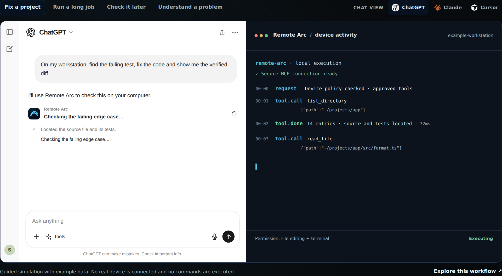
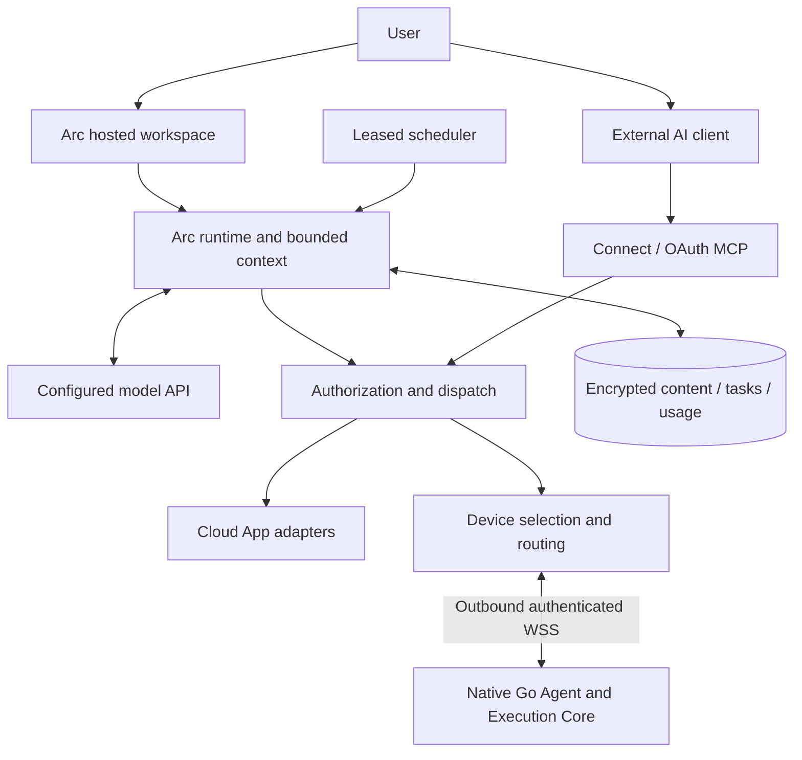

<div align="center">


# Remote Arc

**Agent infrastructure for real work across your apps and computers.**

Arc is your hosted AI teammate. Connect brings the same authorized Apps and device execution to the AI client you already use. Remote Arc manages the context, permissions, persistent work, device placement and usage around model decisions so work can proceed from a request to an inspectable result.

[Website](https://remotearc.app) · [Open Arc](https://agent.remotearc.app/dashboard/agent/chat) · [User guide](https://remotearc.app/docs/start-here) · [Architecture](./ARCHITECTURE.md) · [Security](./SECURITY.md)

<sub>Source available for transparency and security review under a [proprietary license](./LICENSE). Not open-source licensed.</sub>

[](https://github.com/Remote-Arc/remote-arc/actions/workflows/ci.yml) [](https://m8ven.ai/mcp/yaohuangguan/remote-arc)

<p>
  <sub><b>Measured test coverage</b></sub><br />
  <a href="https://github.com/Remote-Arc/remote-arc/tree/coverage-badges"></a>
  <a href="https://github.com/Remote-Arc/remote-arc/tree/coverage-badges"></a>
  <a href="https://github.com/Remote-Arc/remote-arc/tree/coverage-badges"></a>
  <br />
  <a href="https://github.com/Remote-Arc/remote-arc/tree/coverage-badges"></a>
  <a href="https://github.com/Remote-Arc/remote-arc/tree/coverage-badges"></a>
  <a href="https://github.com/Remote-Arc/remote-arc/tree/coverage-badges"></a>
</p>

<sub>Latest validated statement coverage; target ≥90%. Apps and Relay overlap TS/TSX. [Scope, other metrics and source](./docs/test-coverage.md).</sub>

</div>

<p align="center">
  <a href="https://remotearc.app/#how-it-works">
    
  </a>
  <br />
  <sub>Chat → Remote Arc → your computer. Animated preview from the interactive demo in PR #101 (example data, no real device commands). Click to explore the workflow.</sub>
</p>

## Two ways to work

| Product | Start here | What it does |
| --- | --- | --- |
| **Arc** | [Hosted workspace](https://agent.remotearc.app/dashboard/agent/chat) | Chat with a personal agent, use connected Apps/computers, reuse Skills, and create one-off Tasks or recurring routines. |
| **Connect** | [Connect your AI](https://remotearc.app/connect-ai) | Use authorized cloud accounts, paired devices and your browser from compatible ChatGPT, Claude, Codex, Cursor or other MCP clients. |

Arc keeps a delegated responsibility together: its sources, instructions, conversation and run history, with fresh bounded judgment when scheduled and checks against actual results. Start with a daily work brief, project check-in, delivery verification or change follow-up. The [use-case catalog](https://remotearc.app/use-cases) also keeps Arc and Connect paths for all 15 concrete workflows.

Every plan includes every Connect tool. **Free** has monthly Connect call and file-transfer allowances and up to 2 computers. **Connect Unlimited** removes the call and computer limits for people who bring their own AI client; it includes no hosted models. **Plus** and **Pro** add Arc-hosted AI with monthly Credits. Every account can activate a one-time 14-day Arc trial. Users never supply a model API key. Current prices and allowances are on the [pricing page](https://remotearc.app/pricing); third-party App charges are separate. Preview environments use simulated data.

## From a goal to a result

1. **Connect what the work needs.** Authorize a cloud account in Apps, or pair a computer for local files, commands and installed software. Cloud Apps do not require a local computer.
2. **Describe the outcome.** Ask for an inbox summary, an issue with a returned link, or a deployment check. Type `@` in Arc Chat to reuse a selected cloud/imported skill, then describe the desired result.
3. **Execute within current permissions.** Models interpret, plan, choose tools and summarize. Arc supplies bounded context, typed operation contracts, authorization, dispatch, persisted observations and cost accounting.
4. **Inspect the result.** A connection check or successful individual tool call is not the whole goal. Chat presents the final answer; Activity provides execution details. Missing permissions, engines, devices or budgets must be reported as blockers.
5. **Keep ongoing work.** Ask Arc to save a one-off Task or a routine with accounts, timing and timezone. Runs are persisted and scheduled; failed or uncertain recurring work pauses for inspection.

## Earn trust through execution

- **Evidence:** return observed content, an acknowledged resource or a concrete blocker; a tool call alone is not task completion.
- **Boundaries:** current account permissions and local policy apply to each action; skill text and messages cannot grant more authority.
- **Continuity:** retain useful context and results; stop rather than blindly repeat an uncertain external write.
- **Control:** users can stop work, revoke connections, inspect Activity and manage memory; budgets bound hosted execution.

The run status records whether execution ended. Verify the answer and its evidence to assess the goal. The technical reference describes current tests and limits instead of promising that an agent can complete any possible task.

## Platform capabilities

- **Connected Apps:** account-owned, typed provider operations with live scope checks, stable request identities and recorded outcomes.
- **Tasks and routines:** saved goals, schedules, leases, bounded hosted runs and result history. Connect also supports deterministic background commands and checks.
- **Verified results:** optional exact account/resource contracts, independent result checks and source-derived execution receipts. See the [user guide](https://remotearc.app/docs/trust) and [feature map](./docs/feature-map/README.md).
- **Browser work:** the Chrome Companion shares tabs and allowed sites from the user's own browser; the task browser runs site-scoped page work with checkpoints, user handoff and submission receipts.
- **Skills:** reusable cloud instructions and imported SKILL.md references, such as Safe Cleanup for disk-space recovery. A skill does not install its required engine, scripts or dependencies.
- **AI Teams (beta):** configurable employees with their own model, instructions and scoped resources, in direct or group conversations with visible handoffs.
- **Context and memory:** relevant prior observations and learned IDs within a chat, plus bounded encrypted personal notes and work summaries users can inspect and delete.
- **Device fleet:** filter by ownership, tools, workspace and availability before balancing fresh capacity. Projects are not moved implicitly.
- **Local control:** read-oriented initial setup, explicit file/terminal/browser permissions, trusted roots, sensitive-path checks and supported Local Undo.
- **Outbound connectivity:** paired Windows, macOS and Linux computers connect outward; no public inbound port or VPN is required.
- **Operating controls:** versioned plan configuration, Stripe subscriptions and receipts, Credits, funding reservations, separate paid/sponsored budgets and admin usage visibility.

## Architecture

<p>
  <sub><b>Runtime &amp; protocol</b></sub><br />
  <a href="https://go.dev/"></a>
  <a href="https://nodejs.org/"></a>
  <a href="https://www.typescriptlang.org/"></a>
  <a href="https://modelcontextprotocol.io/"></a>
  <br />
  <sub><b>UI &amp; cloud</b></sub><br />
  <a href="https://react.dev/"></a>
  <a href="https://vite.dev/"></a>
  <a href="https://developers.cloudflare.com/workers/"></a>
  <a href="https://developers.cloudflare.com/durable-objects/"></a>
  <a href="https://developers.cloudflare.com/d1/"></a>
</p>



Remote Arc is not remote-desktop software, and it is more than an MCP server: it turns AI decisions into authorized, traceable actions. The model is the reasoning component; Remote Arc owns the execution and continuity layer. Provider data, skill text, files and memory remain untrusted observations. Unknown external effects are retained for inspection and are not blindly repeated. A completed run is not a universal semantic proof of success; inspect the returned evidence.

### Life of one tool call

1. **Authenticate.** The AI client calls `mcp.remotearc.app/mcp` with an OAuth token scoped to the work it may do.
2. **Authorize.** The Worker checks the scope, the account's allowance, device ownership and revocation, and the device's saved tool policy.
3. **Route.** The account's Durable Object forwards the call over the computer's own outbound WebSocket and keeps no copy of the payload.
4. **Check locally.** The Agent re-checks the permission mode, Trusted Write Locations, sensitive paths and, for terminal commands, Safety Guard.
5. **Execute and record.** The Execution Core runs the tool and keeps a Local Undo snapshot for supported edits. The result, usage and activity are recorded.
6. **Decide again.** The AI sees the real observation and chooses the next step. A lost reply is treated as unknown, never silently retried.

Arc runs follow the same gates from step 2 onward, with the model loop running in a Durable Object under a Credits budget. Durable Tasks reach step 3 through a leased scheduler instead of a live chat. Start with [ARCHITECTURE.md](./ARCHITECTURE.md) for the code map, request paths, data stores and contributor rules.

Read the [current engineering reference](./docs/agent-platform-architecture.md) for run state, context reuse, security boundaries, memory limits, scheduling, funding and validation. [Public technical documentation](https://remotearc.app/docs/architecture) explains the same system for users. AI Teams (configurable employees, direct/group conversations and scoped teammate handoffs) is a beta release candidate at `/dashboard/agent/teams`, with its production rollout tracked separately; see the [feature map](./docs/feature-map/ai-teams.md). Cross-run persistent goal continuation and full root-outcome acceptance remain incomplete; see the [implementation/design status](./docs/ai-teams-and-persistent-work.md). Ordinary Connect cannot wake an arbitrary external chat.

## Quick start

For hosted Arc, [sign in](https://agent.remotearc.app), activate the trial or choose a plan, connect an App and describe your goal. Install a device Agent only for work that needs your computer:

```bash
npx remotelink@latest
```

The npm launcher installs and checksums the native Go Agent and Execution Core. Run `npx remotelink@latest` to upgrade: an older idle Go Agent is replaced automatically, while active work asks for confirmation. Pairing and permissions are preserved. Standalone and Homebrew installations need no Node.js.

<!-- native-install:start -->
### Native downloads and Homebrew

Standalone 0.6.5 needs no Node.js or Go compiler. [Installation and upgrade guide](https://remotearc.app/downloads).

On macOS or Linux (including WSL), install without Node.js:

```sh
curl -fsSL https://remotearc.app/install.sh | sh
remotelink
```

The script verifies SHA256, installs to ~/.local/bin without sudo, and leaves pairing and permissions for the first launch. Set REMOTEARC_INSTALL_DIR to an absolute path to choose another directory. Rerun the installer to upgrade after stopping the Agent.

| Platform | Download |
| --- | --- |
| macOS Apple Silicon | [remotelink](https://github.com/yaohuangguan/remote-arc/releases/download/remotelink-v0.6.5/remotelink-v0.6.5-darwin-arm64) |
| macOS Intel | [remotelink](https://github.com/yaohuangguan/remote-arc/releases/download/remotelink-v0.6.5/remotelink-v0.6.5-darwin-amd64) |
| Windows x64 | [remotelink](https://github.com/yaohuangguan/remote-arc/releases/download/remotelink-v0.6.5/remotelink-v0.6.5-windows-amd64.exe) |
| Windows ARM64 | [remotelink](https://github.com/yaohuangguan/remote-arc/releases/download/remotelink-v0.6.5/remotelink-v0.6.5-windows-arm64.exe) |
| Linux x64 | [remotelink](https://github.com/yaohuangguan/remote-arc/releases/download/remotelink-v0.6.5/remotelink-v0.6.5-linux-amd64) |
| Linux ARM64 | [remotelink](https://github.com/yaohuangguan/remote-arc/releases/download/remotelink-v0.6.5/remotelink-v0.6.5-linux-arm64) |

[SHA256SUMS](https://github.com/yaohuangguan/remote-arc/releases/download/remotelink-v0.6.5/SHA256SUMS) · [Release notes](https://github.com/yaohuangguan/remote-arc/releases/tag/remotelink-v0.6.5)

```bash
brew tap yaohuangguan/remote-arc https://github.com/yaohuangguan/remote-arc
if brew command trust >/dev/null 2>&1; then brew trust --formula yaohuangguan/remote-arc/remotelink yaohuangguan/remote-arc/remotelink-go; fi
brew install yaohuangguan/remote-arc/remotelink
remotelink
```

The existing `remotelink-go` formula remains available for upgrades; install one formula at a time.
<!-- native-install:end -->

For Connect, authorize your compatible AI client against:

```text
https://mcp.remotearc.app/mcp
```

Pairing a computer and authorizing an AI client are separate, revocable relationships. See [installation](https://remotearc.app/downloads), [Apps](https://remotearc.app/docs/apps), [Tasks](https://remotearc.app/docs/tasks), [Skills](https://remotearc.app/docs/skills) and [memory](https://remotearc.app/docs/memory).

## Monorepo

```text
remote-arc/
├── apps/
│   ├── agent/             Native Go device Agent: pairing, relay, recovery, journals
│   ├── browser-extension/ Chrome Companion: shared tabs and allowed sites
│   ├── ui/                React Arc / Connect / Admin, website, checkout and documentation
│   ├── relay/             Cloudflare Worker: Arc runtime, Apps, tasks, billing, OAuth, MCP and D1 migrations
│   └── mcp/               MCP integration tests against the Go Agent
├── packages/
│   ├── execution-core/    Independent Go module: files, processes, policy, Safety Guard and Undo
│   ├── cli/               npm installer/launcher for the Go Agent
│   ├── protocol/          Shared wire types and plan defaults for Relay and Dashboard
│   ├── skills/            Generated Skill catalog and community Skills
│   └── docs/              Generated documentation and tool index
├── skills/                Source for first-party Skills (for example safe-cleanup)
└── tools/saas/            SaaS pricing and unit-economics models
```

The Go Agent and Execution Core compile into one executable; extracting the core
does not introduce an IPC boundary. The core can be built/tested independently
with Go. The cloud Relay and Dashboard remain TypeScript.

## Native execution core

Remote Arc implements its local computer capabilities directly with Go and OS
APIs.

Current native tools:

```text
list_directory
browse_directories
read_file
read_binary_file
get_file_info
list_processes
write_file
edit_block
list_undo_actions
undo_change
undo_last_change
start_process
process_status
process_output
list_managed_processes
stop_process
```

The primary core uses Go's `os`, `filepath`, `os/exec`, `context` and native
platform APIs. It owns bounded process output, cancellation, atomic replacement,
local Undo evidence, conflict fences and path policy. The Agent adds authenticated
outbound sessions, device configuration, checkpoints and local execution journals.

Atomic replacement and explicit durable synchronization are separate policies.
TS retains its atomic default; Go retains its durable default. This release does
not claim complete hardware power-loss protection. See the
[persistence validation](./docs/go-persistence-validation.md) and
[system architecture](./docs/system-architecture.md) for boundaries and evidence.

## Permission model

New devices start with the Safe preset.

### Safe

Read-only local capabilities:

```text
list_directory
read_file
read_binary_file
get_file_info
list_processes
```

The native core also has internal dashboard capabilities such as
`list_undo_actions` and `browse_directories`. They let the authenticated
Remote Arc dashboard load local recovery metadata and browse selectable folders
without turning those controls into normal hosted AI skills.

### Developer

Safe plus reversible file editing:

```text
write_file
edit_block
undo_last_change
```

The dashboard can additionally invoke the internal `undo_change` operation to
restore a selected local snapshot.

Developer mode does **not** include arbitrary terminal execution.

### Full

Developer plus:

```text
start_process
process_status
process_output
stop_process
```

`start_process` can run synchronously or return a local process handle for a
managed background process. Output and status stay on the device and are read
through the same authenticated Remote Arc tool path. The dashboard uses the
internal `list_managed_processes` capability to show these Remote Arc-managed
jobs and lets the user inspect output or stop a running process.

Presets are shortcuts. The actual hosted policy is an individually editable
per-device skill list.

## Durable Automations

Remote Arc can persist deterministic work independently of the chat session that created it. MCP clients need the separate `automation:read` / `automation:write` OAuth scopes to inspect or create persistent work; ordinary `computer:write` access does not grant that authority.

Four production task modes share the same durable task engine:

- **Long task** — start a command and keep tracking it after the MCP call/chat ends.
- **Condition watch** — wait for a webhook event, then execute an approved plan.
- **Schedule watch** — execute a plan on a recurring interval or at a future time.
- **Goal loop** — repeat a fixed work plan, execute a verification command, and retry until verification succeeds, the task expires, the run limit is reached, or the user stops it.

Condition watches may also use a cloud-side GitHub App merge action. A matching CI webhook can therefore merge an explicitly configured pull request without depending on a paired computer being online.

Automation state lives in D1 and is advanced by the Worker scheduler or webhook events. Device execution still goes through the same authenticated Durable Object route and the device's existing skill/path policy.

Creating an automation snapshots the current device permission policy. Routine disconnects and local agent restarts do not introduce an approval step: unattended work waits for the device and automatically recovers. If you later change the device security policy itself, Remote Arc stops that automation rather than silently inheriting a different trust boundary.

A device going offline moves eligible work to `waiting_for_device`; it does not automatically fail the automation. Deterministic long-running work defaults to automatic attempt restart if the local agent reconnects without its previous managed-process handle. For fresh AI judgment, Arc hosted tasks invoke their configured model within current limits. Deterministic Connect tasks need an available supported reasoning host for new decisions; this does not imply an autonomous wake loop into arbitrary external chats.

The background agent and automation engine solve different problems:

- the background agent keeps a paired device available and reconnecting without an open terminal window;
- the automation engine preserves task state and triggers independently of an MCP request or chat lifetime.

A sleeping, powered-off, or disconnected computer is not considered online. Device-backed work resumes only after the agent reconnects.

Running:

```bash
npx remotelink --safe
```

adds a local hard read-only cap that the dashboard cannot expand.

## Local Undo

Before supported `write_file` and `edit_block` operations, Remote Arc stores
the previous file state locally under:

```text
~/.remotearc/undo
```

Properties:

- snapshots stay on the device
- snapshots are not uploaded to Remote Arc Cloud
- snapshots expire after 7 days
- the local store is capped at 200 MB
- individual files larger than 20 MB are not snapshotted
- undo verifies the post-edit file hash before restoring
- if a file changed again afterward, automatic undo refuses to overwrite it

Local Undo cannot reverse external side effects such as deployments, package
publishing, network requests, or remote database mutations.

The dashboard can load undo metadata directly from an online device on demand
and restore a specific action. Each row reports whether the current file still
matches the recorded post-edit state. Conflicted, missing, or legacy snapshots
are shown as unavailable instead of attempting an unsafe overwrite. Undo history
is not persisted in D1 or another Remote Arc cloud store.

## Sensitive Path Policy

Sensitive-path protection is enabled by default in the native execution core.

Built-in protected locations include common credential and profile areas such
as:

```text
~/.ssh
~/.aws
~/.gnupg
~/.azure
~/.kube
~/.docker
~/.config/gcloud
browser profile directories
.env and .env.*
```

Users can add additional protected paths per device in the dashboard. When a
specific project genuinely needs a protected file such as one `.env`, users can
add a narrow sensitive-path exception for that exact file or directory without
turning off protection globally. A sensitive-path exception grants visibility
only; it does not create write authority outside Trusted Write Locations.

Path checks happen again on the local device immediately before filesystem
execution. Canonical-path checks prevent a symlink inside a trusted write
location from turning a permitted mutation into an out-of-scope write.

The selected trusted-write/protected-path strings are control-plane policy
metadata stored in D1; saving a path does not copy its file contents. Durable
deterministic Tasks store only the task contract, bounded run state and result
metadata needed for their lifecycle.

## Trusted Write Locations and boundary approvals

A device can define one or more Trusted Write Locations. These are the folders
where supported file mutations may happen repeatedly without asking for a new
approval every time. The dashboard supports manual path entry and a
device-backed directory picker.

Trusted Write Locations are deliberately **not** the AI's visible world.
Read-only filesystem tools may inspect ordinary non-sensitive files outside
those locations. Supported mutations such as `write_file` and `edit_block`
must stay inside a Trusted Write Location or receive a narrowly scoped boundary
approval before execution.

An out-of-scope write can be approved once, allowed briefly for the same
file/tool, promoted by trusting the parent folder, or denied. One-shot approvals
are consumed after successful execution. Approval metadata is bound to the
account, device, OAuth client/grant, tool, target path and request details.

For Full mode, `start_process` remains a separate high-risk capability. When
Trusted Write Locations exist, terminal calls require an in-scope `cwd`, but
that check is **not** an operating-system sandbox: a shell running from an
allowed directory may still reference other paths, credentials, network
services or child processes.

## Native-core reliability

File rewrites and targeted `edit_block` changes use same-directory temporary
files followed by rename, reducing the risk of leaving partially written files
after an interrupted write. Append mode remains append semantics and is not
described as an atomic rewrite.

## Safety Guard

Terminal execution is available only when the device policy allows
`start_process`.

Before a terminal command runs, both execution cores (Go and TS, with shared
test cases) check it. Safety Guard 2.0 judges a delete by where it would
actually land, not by how the command is written:

- it tokenizes with the real shell's rules (`cmd.exe`, PowerShell, POSIX `sh`)
  and follows nested layers such as `cmd /c`, `powershell -EncodedCommand`,
  `sh -c` and invoked scripts;
- it tracks `cd`/`Set-Location` and simple assignments, and expands environment
  variables, `~`, wildcards and pipeline sources from the command's real `cwd`;
- it refuses deletes that land on drive, volume or share roots, home and personal
  folders, user-profile roots, system folders, credential stores or the
  `.remotearc` Undo store;
- it refuses delete targets it cannot resolve unambiguously, such as unset
  variables, command substitution or unbalanced quotes;
- narrow cleanup stays allowed, for example `node_modules`, temp folders and
  caches.

Disk formatting, raw-disk overwrite, fork bombs and machine shutdown/reboot
remain blocked. For bulk disk-space recovery, use the `safe-cleanup` Skill.
`REMOTEARC_ALLOW_DESTRUCTIVE=1` disables the guard locally.

The Safety Guard is defense in depth, not a complete OS sandbox.

## Authentication and trust boundaries

Remote Arc separates four identities:

1. dashboard user
2. MCP client
3. paired device
4. live device connection

### Dashboard

Users sign in with Google or a passwordless email code; both share one account
and session model. The Worker creates a secure HTTP-only session, and
cookie-authenticated mutations must come from the first-party dashboard origin.

### MCP client

Remote MCP uses OAuth 2.1 authorization code flow with PKCE and dynamic client
registration. The Security dashboard tracks each OAuth authorization instance
separately and labels it as active, refreshable, or expired. Revoking one grant
invalidates that client authorization without revoking paired computers or
other AI-client grants.

Discovery:

```text
/.well-known/oauth-protected-resource
/.well-known/oauth-authorization-server
```

OAuth endpoints:

```text
/oauth/register
/oauth/authorize
/oauth/token
```

### Device

Every paired device receives its own revocable credential.

The raw device credential is stored locally in:

```text
~/.remotearc/config.json
```

The hosted database stores only its SHA-256 hash.

### Routing

Live devices connect outbound over WebSocket to a per-user Durable Object.
Remote Arc does not require inbound access to the computer.

## Cloudflare deployment

Production:

```text
Website:   https://remotearc.app
Dashboard: https://agent.remotearc.app
Admin:     https://admin.remotearc.app
MCP:       https://mcp.remotearc.app/mcp
Health:    https://mcp.remotearc.app/health
```

The hosted architecture currently uses:

- Cloudflare Workers
- Workers Static Assets
- per-user Durable Objects
- D1 for control-plane state
- outbound device WebSockets
- Stripe for subscriptions and payments

Static JS/CSS/assets bypass the Worker runtime so normal website traffic does
not unnecessarily consume the Workers request quota.

**Merging does not deploy production.** Production is an explicit promotion: the
owner runs the manual **Production Release - D1 + Relay + Website** workflow
(`.github/workflows/deploy-cloudflare.yml`) on `master`, behind the `production`
environment. It runs these steps:

1. Confirms the exact `master` SHA has a successful CI run.
2. Takes a verified D1 backup.
3. Applies pending migrations.
4. Deploys the Relay Worker and website assets.
5. Runs smoke checks.
6. Optionally activates live Stripe or hosted models.

A newer `master` commit stops an older release. npm and Go Agent publishing are
separate release steps.

Local `pnpm deploy:relay` is blocked so a second Wrangler deploy cannot race the
release workflow. For an emergency-only manual production deploy, use:

```bash
REMOTEARC_MANUAL_PROD_DEPLOY=1 pnpm deploy:relay
```

Every allowed deploy writes the verified Git SHA into the Cloudflare version tag
and message so production history can be traced back to its source commit.

## Remote MCP tools

Hosted MCP registers 44 tools, available on every plan. Which ones a client sees still depends on deployment switches, OAuth scopes, the selected device's policy and its live capabilities. App operations are grouped behind the three Apps tools and are not counted separately. See the [complete tool inventory](./docs/connect-tool-inventory.md):

```text
Devices and Fleet  list_devices, device_tools, fleet_dispatch, fleet_sync_workspace
Files              list_directory, read_file, read_binary_file, get_file_info, write_file,
                   edit_block, undo_last_change, create_file_resource, revoke_file_resource
Processes          list_processes, start_process, process_status, process_output,
                   stop_process, list_agent_sessions
Tasks              create_automation, list_automations, get_automation, manage_automation
Agent Goals        create_agent_goal, get_goal_context, submit_goal_decision (experimental)
Task browser       browser_runner_start, browser_runner_snapshot, browser_runner_act,
                   browser_runner_wait, browser_runner_confirm, browser_runner_status,
                   browser_runner_close
Shared tabs        shared_tab_list, shared_tab_read, shared_tab_open, shared_tab_act,
                   shared_tab_click, shared_tab_fill
Apps               list_apps, run_app_read_action, run_app_write_action
Skills             find_skills, read_skill
```

The automation tools create and manage durable deterministic control-plane state. They do not grant new device capabilities: when an automation executes on a computer, the normal device ownership, skill policy, Trusted Write Locations, boundary approvals and Sensitive Path Policy checks still apply. Per-device task permissions independently govern background, scheduled and keep-awake behavior.

Agent Goals are experimental. In source mode the external AI submits each decision; hosted mode additionally needs hosted model access and budget. A saved goal does not guarantee that an external chat is woken automatically.

See [the complete system architecture](docs/system-architecture.md),
[implementation plan](docs/long-running-work-plan.md),
[resume checkpoint](docs/long-running-work-progress.md) and the website guide
at `/docs/long-running-work`. Real Plugin/Chat/Work overnight acceptance remains
pending. Local Wrangler tests prove relay execution/recovery, not host lifetime.

Before a device call is forwarded, the relay verifies:

- authenticated MCP user
- device ownership
- device revocation state
- saved per-device skill policy
- currently advertised device tools

## Development

Requirements:

- Node.js 24+ for the TypeScript development tools and SQLite test suite (npm/npx installation: Node.js 20+; native downloads and Homebrew need no Node.js)
- Go 1.25 (toolchain 1.25.5) for native Agent and Execution Core development
- pnpm 10.17
- Cloudflare Wrangler for relay work (installed as a workspace dependency)

Install:

```bash
git clone https://github.com/Remote-Arc/remote-arc.git
cd remote-arc
pnpm install
pnpm run ci
```

Useful commands:

```bash
pnpm dev:mcp
pnpm dev:agent
pnpm dev:relay
pnpm dev:ui

pnpm build:cli
pnpm build:ui
pnpm test:deploy-policy
# production releases run only through the manual Production Release workflow
```

Relay suites are split by area, for example `pnpm --filter @remotearc/relay test:stripe`, `test:security` and `test:apps`; `pnpm test:goals` covers durable task and goal continuation.

Run only the native Execution Core tests:

```bash
go -C packages/execution-core test ./...
```

The GitHub CI matrix runs the Go device and MCP integration tests on:

```text
Ubuntu
Windows
macOS
```

## Publishing the CLI

The npm package name is:

```text
remotelink
```

Product name:

```text
Remote Arc
```

The package also exposes these CLI aliases:

```text
remotelink
remote-link
remote-arc
```

The published CLI downloads the matching native Agent and verifies its SHA-256
digest. End users do not install a separate execution server.

Release content has one source of truth: `CHANGELOG.md`. Each release section uses
`## <version> - <date>`, one `### <title>`, and bullet changes. Run:

```bash
pnpm release:sync
pnpm release:check
```

`release:sync` updates the npm README's Latest release block. The website Releases
page reads the same CHANGELOG at build time, and the GitHub Release workflow uses
the same section as its release notes. CI fails when the package version and latest
CHANGELOG section drift apart.

npm publishing uses GitHub Actions OIDC Trusted Publishing with provenance.

The npm Trusted Publisher configuration must match:

```text
Organization or user: yaohuangguan
Repository:           remote-arc
Workflow filename:    publish-remotelink.yml
Environment name:     production
Allowed action:       npm publish
```

## Security model

Remote computer access is high impact. Remote Arc therefore starts from a
restricted capability model instead of granting unrestricted terminal access.


Current protections include:

- read-only default preset
- individually editable device skills
- local hard Safe mode
- per-device credentials
- hashed device credentials in D1
- OAuth 2.1 + PKCE
- per-user Durable Object routing
- revoked-device checks before MCP forwarding
- outbound-only device connections
- Local Undo for supported file changes
- on-demand Local Undo history from the device
- Sensitive Path Policy enabled by default
- configurable Trusted Write Locations and boundary approvals
- canonical/symlink-safe filesystem path enforcement
- atomic rewrite/edit operations
- Safety Guard 2.0: delete targets resolved before terminal commands run
- optional background recovery at login
- no Desktop Commander dependency

Still planned before broader public use:

- stronger secret redaction in audit metadata
- more granular command/network policy
- signed/notarized installers
- automatic Agent updates (today, rerunning the installer or `npx remotelink@latest` upgrades)

## Roadmap

### Shipped

- [x] Cloudflare relay, D1 control plane and per-user Durable Object routing
- [x] Google and passwordless email sign-in; OAuth 2.1 + PKCE Remote MCP
- [x] native Go Agent and Execution Core, with npm, standalone and Homebrew installs
- [x] Safe / Developer / Full presets, Local Undo, Sensitive Path Policy, Trusted Write Locations
- [x] Safety Guard 2.0 and the Safe Cleanup Skill
- [x] managed background processes and background recovery at login
- [x] durable Tasks: long tasks, schedules, condition watches and goal loops
- [x] hosted Arc workspace with Apps, Skills, memory and a 14-day trial
- [x] Free, Connect Unlimited, Plus and Pro plans, with Stripe checkout including one-tap wallets
- [x] Chrome Companion shared tabs and the task browser
- [x] device Fleet dispatch and workspace sync
- [x] manual, gated production release workflow
- [x] Windows/macOS/Linux CI

### In progress

- AI Teams beta rollout
- signed macOS app and DMG packaging
- ChatGPT and Claude connector directory listings
- experimental Agent Goals and persistent goal continuation

### Next

- signed/notarized installers on every platform and automatic Agent updates
- finer command/network policy for Full mode
- stronger audit-metadata redaction and production abuse controls
- broader multi-user security review

## License

Remote Arc is **source-available, not open source** for current releases.

The current source is licensed under the
[Remote Arc Proprietary Source License](./LICENSE). Viewing and security review
are permitted, but modification, redistribution, white-labeling, and commercial
exploitation require written permission.

Historical revisions previously released under MIT remain governed by the MIT
terms that applied to those revisions.

Third-party components continue to use their own licenses.
