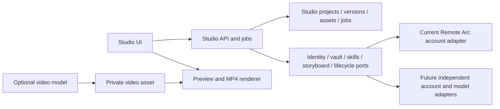

# ReArc Studio

Studio is a separate application inside the monorepo. It owns its document format,
UI, templates, preview/MP4 engine, project API, private media, versions and job
lifecycle. It imports no Remote Arc application or protocol package.

Requires Node 24+. To work on Studio alone, copy this directory, install its
dependencies and run:

```sh
npm install
npm run dev
```

This starts its UI and an **explicitly local-only** API on 127.0.0.1:4331/4332.
The local adapter has a development identity, encrypted SQLite storage and no
paid AI. It does not create or access an Agent/account database. In the monorepo,
use the root lockfile: `pnpm install --frozen-lockfile && pnpm dev:studio`.

`npm run build` produces the standalone static app in `dist/`. The monorepo release
build separately produces the Agent UI and Studio, then places Studio assets
under `/studio/`. The Worker serves Studio's own HTML on studio.remotearc.app and
the Agent host's `/studio` path. Opening Studio does not load the Agent bundle.

## Boundaries



- `core/document.ts`: stable portable document/asset contract; no runtime deps.
- `src/`: bilingual editor, preferences, templates and deterministic media output.
- `server/service.ts`: authenticated same-origin domain API. No Agent runtime,
  chat tables, provider SDK, account database or credentials are imported here.
- `server/ports.ts`: application host services. Authentication has no default;
  production requests need a real identity adapter. Vault data is owner/project
  bound. Lifecycle hooks participate in the project's atomic transaction.
- `server/runtime.ts` and `worker.ts`: reusable Cloudflare orchestration/composition.
- `migrations/0001_studio.sql`: four Studio tables with no external foreign keys.
- `scripts/local.ts`: loopback development composition; never a production auth
  mechanism. Settings/data are kept under the selected `STUDIO_DATA_DIR`.

The current shared deployment plugs in
`apps/relay/src/studio-platform.ts`. It reuses Remote Arc accounts, vault,
entitlements, skills and model accounting through these ports. A project owns a
generic billing workload; no Arc chat session is created. The ledger checks
workload owner, organization, active status, grants and budgets atomically.
Studio-specific model settings can use `STUDIO_AI_ENABLED`, `STUDIO_MODELS` and
`STUDIO_AUTO_MODEL_ID`; absent overrides preserve the existing account model setup.
They do not require the Agent chat feature or Agent Durable Object to be enabled.

## Future model integration

Storyboard models return validated scene data. Video models produce private
media assets. The renderer composes assets, text, captions and sound into a final
MP4. These are three different responsibilities.

`server/providers.ts` describes a **future integration boundary**, not an enabled
video service. No video-model vendor or paid generation endpoint is configured.
An adapter must persist its provider job ID, use an idempotency key, reserve and
settle its own usage, retain unknown outcomes without automatic replay, import
results into owner-scoped storage, and honor ownership/cancellation on polling.
Generated clips attach to scene asset IDs; they cannot overwrite a whole project.

## Splitting operations later

The application directory can move to a separate repository. Deploy its own UI,
D1/storage and runtime; implement the account/vault/skills/model/lifecycle ports;
then route `/api/studio/*` to that service on the same origin. The current
Remote Arc account/credit adapter remains a deliberate integration choice, not
Studio's business model. Separate subscriptions, checkout, identity-provider
selection and live video-model adapters still require implementation/configuration.

For existing projects, additive Relay migration 0069 preserves ciphertext,
revisions, media keys and job receipts while removing the old session relationship.
Retain vault keys and preserve owner IDs during any data move, or explicitly
decrypt/re-encrypt through an authorized migration. `.arcvideo` exports include
referenced original media and remain compatible across these deployments.

## Verification

`npm run test:independent` runs with only Studio's schema and an alternate model
adapter. `npm run typecheck` checks both browser and server code. The root
`pnpm test:studio` additionally checks the shared-account integration, real billing
ledger, upgrade preservation and cross-account isolation. Root browser acceptance
downloads and fully decodes actual MP4s from the independent app.
