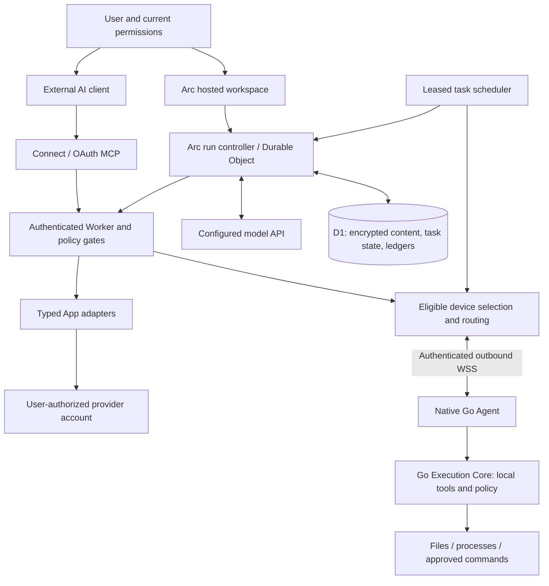

# Remote Arc agent platform: architecture and execution contract

Updated 20 October 2026. This is the current platform reference. The native device stable release and a hosted service deployment have independent versions; 0.6.2-rc.2 is a device candidate, not a stable-version promise. See [user documentation](https://remotearc.app/docs/start-here), [public technical guide](https://remotearc.app/docs/architecture), [release status](https://remotearc.app/releases) and [security policy](../SECURITY.md).

## Product and responsibilities

Remote Arc is infrastructure for agents to act on authorized cloud accounts and user-owned computers. **Arc** is the hosted personal-agent workspace. **Connect** lets compatible external AI clients use the same execution layer over MCP. MCP is an interoperability interface within the platform.

| Responsibility | Model API / external reasoning host | Remote Arc |
| --- | --- | --- |
| Understand and plan | Interpret the goal, select tools, assess observations, summarize | Build bounded context and expose validated tool contracts |
| Authorization | Propose an action; cannot grant itself authority | Verify account, OAuth scopes, entitlement, connection/device ownership and local policy |
| Execute | Return structured decisions | Dispatch App operations or device tools and retain acknowledgements |
| Continuity | Make fresh decisions when invoked | Persist conversations, steps, references, task schedules, leases and outcomes |
| Memory | Use relevant supplied context | Store, retrieve and delete bounded account-owned notes and work summaries |
| Cost | Report model usage | Reserve and settle funds/Credits; enforce run, account and operating limits |

OpenAI or Anthropic APIs supply reasoning. They do not independently connect a user's Gmail, operate the user's computer, persist Arc routines or manage Arc's account memory. Arc's runtime organizes those capabilities around model decisions. Model output remains fallible: a completed run is a terminal runtime state, **not a formal proof that the user goal is satisfied**. Answers must cite real observations or artifacts and distinguish partial work and blockers.

## Execution topology



The Agent and Core compile into one executable, not two network services. Apps execute in the cloud and do not require a local device. Local software and device tools are needed only when the selected workflow actually depends on them. Browser sharing has its own explicit tab and interaction grants.

## A hosted run, from goal to evidence

1. Authenticate the request and resolve the account's active plan or trial. Save a request identity and input hash; a retry with changed input conflicts instead of silently creating another effect.
2. Persist the user message and any validated, account-owned skill references in encrypted chat content. Compose context from the goal, recent requests, relevant prior observations/arguments, active connections, selected memories and current device metadata.
3. Reserve cost before model dispatch. Validate the model's structured decision and tool arguments. An invalid decision and a failed usage settlement have distinct diagnostics.
4. Before an effect, check current access and the target's ownership, schema, scope and policy. An argument error caught before provider dispatch becomes a correctable observation. It is not reported as an ambiguous external write.
5. Record the dispatch boundary and result. The next decision receives executed arguments and bounded observations, including real resource IDs, status, URLs and pagination. Acknowledged identical actions within a run reuse the saved result; uncertain writes are not blindly replayed.
6. Continue to a final answer, a concrete blocker, cancellation or a bounded limit. Recent inbox summarization uses a read-only content path and a reply-only closing decision. Other workflows use individual validated operations as needed.

Discovery is not completion. Listing a connected Gmail account does not read its messages. A deployment list is not necessarily evidence of readiness; inspect the appropriate deployment state. A successful issue creation should return its acknowledged issue ID/link. When evidence is absent, the answer must say so. These are task-specific completion criteria enforced through contracts, observations, model instructions and acceptance tests; there is no universal semantic verifier for arbitrary goals.

## Context reuse and memory

`arc-task-state.ts` reconstructs goals, discoveries, learned schemas and completed/failed actions from persisted conversation history. `arc-chat-context.ts` fits a bounded prompt, retaining useful current observations before optional material. Large results are shortened structurally so resource identifiers survive; excerpts do not authorize inventing omitted data.

Discovery reuse currently covers connected Apps for 120 seconds, device discovery for 20 seconds, and App schemas / skill instructions / skill catalog for 30 minutes. Repeated identical discovery within the same run reuses its observation. Actual actions still run live authorization checks. Discovery reuse is an optimization, not a lease on access to a revoked account.

Cross-chat memory is Arc-owned, not the consumer memory of ChatGPT or Claude. Current limits in `packages/protocol/src/index.ts` are 100 short facts, 40 work summaries, 768 bytes per fact, 2,048 bytes per work summary, and 4,000 bytes of retrieved memory context. Personal memory is encrypted with account-bound associated data. Users can inspect/edit/delete facts, remove work entries and disable retrieval. Device registry status is separate from remembered facts. Do not store passwords or API keys in memory.

These limits bound memory content to about 159 KB per fully used account before encryption, indexes and metadata; chat and audit retention are separate costs. The platform does not mirror users' disks or send all past history on every request. Relevant context sent to a model provider is still subject to that provider's processing terms.

## Apps: one execution contract, provider-specific capabilities

All Apps use the shared discovery, schema, account-ownership, scope, usage and idempotency path, with provider-specific adapters behind it. Stable request IDs and durable call records distinguish acknowledged results from unknown outcomes. An App connection does not confer unrelated provider permissions or make separately billed APIs free.

The shared engine can recover from argument errors before dispatch and preserve results for subsequent decisions. It cannot make a provider support an unimplemented operation, repair revoked consent, bypass upstream rate limits or guarantee that every provider account works. Check the published operation catalog and use live account acceptance where appropriate. App content, email, files and skill instructions are untrusted data, never authority to change the user's goal or exfiltrate credentials.

## Tasks, routines and device scheduling

The Tasks surface unifies one-off delegated work and recurring Arc routines. Arc routines persist self-contained instructions plus a schedule and start a new bounded hosted run when due. Daily schedules use an explicit IANA timezone; DST gaps are skipped and repeated local times execute once. Interval routines have a minimum 15-minute period. Runs check access and budgets again and pause repeating work on failed/unknown outcomes.

Connect's deterministic automation engine persists approved commands, triggers, bounded retries and verification separately. It can continue known work without a model continuously reasoning. Source-agent continuation of an arbitrary external ChatGPT/Claude conversation is a different integration; the ordinary MCP endpoint does not promise to wake that chat.

Placement first filters account ownership, online/unpaused state, tools, platform, trusted workspace and task permissions. Ranking then considers active work, CPU/memory, connection health and fresh capacity. Stale telemetry is unknown rather than idle. Windows and WSL agents sharing a host do not count physical capacity twice. Dispatch does not move projects, install missing dependencies or repeat an uncertain write on a different computer. Local policy remains the final execution boundary.

## Skills and @ reuse

The cloud library exposes built-in workflow instructions. Users may also import a bounded SKILL.md; imported content is encrypted per account. A source URL records attribution and does not download a repository, scripts or dependencies.

In Arc Chat, type `@` or use the Skills button to select up to three references. The client submits IDs separately from the goal. The server resolves each ID against that user's imported library or the built-in catalog, stores the canonical name with the message, and includes the references in subsequent context. The runtime reads selected instructions through the existing permission-checked skill tool and reuses observations. Same display names cannot change which skill was selected. References are not extra permissions.

Some built-in cloud workflows execute supported read-only tools. Other skills describe methods requiring an App, software, a connected computer, referenced files or a generation engine. Missing capabilities are a blocked outcome, not a generated image or completed task. Adding Markdown alone does not install them. Custom groups of autonomous developer/designer teammates are a future product direction, not a current execution guarantee.

Slack is currently a user-authorized App tool connection, not a DM/mention conversation entrance. The proposed Bot should map each linked initiating user and thread into the same Arc runtime, without inheriting the installer's private account permissions. See the [Slack entrance design and acceptance requirements](slack-agent-entrypoint.md).

## Billing, configuration and operating limits

Hosted model use reserves and settles Credits and rated cost. Unknown outcomes retain reservations instead of being counted as free. Account plan versions and commercial catalog configuration live in D1; secrets live in protected environment/Worker secrets. Environment variables remain bootstrap/feature switches, not the operator pricing database.

Automatic funding separates sponsored trial capacity from paid capacity based on verified live paid receipts, with a configurable per-paying-user daily ceiling. Sandbox receipts do not fund production usage. Refunds reduce funding availability without erasing incurred model cost. User Credits, per-model limits, concurrency and task limits apply as additional bounds. This is an internal operating budget, not a provider balance reader or automatic recharge system.

Stripe Checkout collects payment; verified webhook/payment state grants the subscription and allowance. A return URL alone cannot activate a plan. Portal manages billing details and subscription lifecycle. Feedback reward campaigns have versioned terms, verified account identity, explicit admin review and atomic capped Connect-call grants. Email drafts and templates do not themselves authorize sends.

## Security, observability and acceptance

| Area | Evidence and boundary |
| --- | --- |
| Tenant isolation | Authenticated account ownership on conversation, App, device, skill and memory access |
| Device control | Read-oriented initial setup; explicit local tools, trusted roots, sensitive paths and OS user authority |
| Uncertainty | Persisted dispatch state; no blind replay after an unconfirmed effect |
| User experience | One working indicator and final answer in chat; execution details fetched on demand in Activity |
| Operations | Model usage and funding pools, trials, payment records, reviewed rewards and service health in Admin |
| Tests | Shared provider contracts, argument correction, duplicate prevention, context reuse, task scheduling, memory isolation, funding and billing lifecycle |
| Protected acceptance | Real model calls against synthetic mail, GitHub creation and Vercel deployment fixtures under a USD 0.05 cap |

Fixtures test actual adapters/controller paths with controlled provider responses; they do not certify every real customer account, provider outage or all possible task categories. A production release must pass exact-commit CI and the applicable acceptance checks. Real customer actions require their authorization. Full two-way multi-agent collaboration, arbitrary engine installation and unconditional exactly-once third-party writes are not claimed.

## Code map and validation

| Location | Purpose |
| --- | --- |
| `apps/relay/src/arc-chat*.ts`, `arc-task-state.ts` | Authenticated chat, state, bounded model/tool loop and context |
| `apps/relay/src/model-gateway.ts`, `billing-ledger.ts`, `arc-funding.ts` | Cost reservations, usage settlement and funding gates |
| `apps/relay/src/app-*.ts`, `apps.ts` | Typed provider operations, credential vault and dispatch |
| `apps/relay/src/arc-work.ts`, `automations.ts`, `fleet-*.ts` | Hosted routines, persistent scheduler and placement |
| `apps/relay/src/arc-memory.ts`, `arc-skills.ts`, `cloud-skills.ts` | Memory and reusable skill instructions/workflows |
| `apps/agent`, `packages/execution-core` | Native local execution and policy |
| `apps/ui`, `packages/docs/src` | Arc / Connect / Admin surfaces and bilingual public documentation |

```sh
pnpm install --frozen-lockfile
pnpm --filter @remotearc/relay test:arc
pnpm --filter @remotearc/relay test:apps
pnpm test:skills
pnpm test:fleet
pnpm --filter @remotearc/relay test:model-billing
pnpm --filter @remotearc/ui test:workspaces
```

The protected `verify-arc-tasks.yml` workflow runs real inference with synthetic provider fixtures; it needs operator authorization and a protected provider secret. Do not put credentials into shell history, docs, test artifacts or issues. The older [system reference](system-architecture.en.md) remains useful for native execution details; use this document for the current platform topology and hosted-runtime contract.
