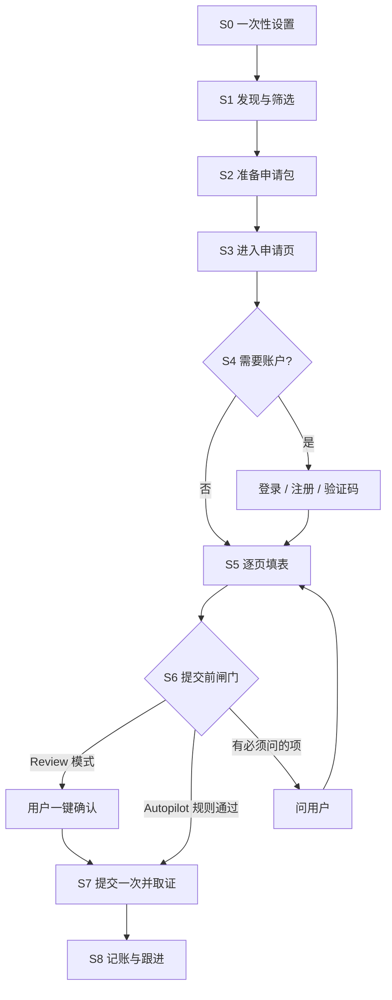

# 自动投递全流程设计（基于 Browser Runner）

状态：设计稿，2026-10-22。关联：Browser Runner epic、#270、#271、#252、#254、#257。

## 1. 定位

自动投递是 Browser Runner（#270）上的第一个场景，不是一个独立产品。我们要做的是底层能力：用户用自己的 AI（ChatGPT、Claude、以后的 Arc），通过 Remote Arc 在自己的设备上操作任意网站，不依赖目标网站的 API。投简历、订票、填政府表格，都是同一套能力。

**宿主无关。** 能力通过 Remote Arc Connect 的 MCP 工具提供，ChatGPT、Claude、Cursor、Codex、Grok 或任何支持 MCP 工具调用的客户端都能用。设计上只依赖所有宿主都支持的部分：工具名、严格的 JSON Schema、有界的工具结果，以及结果里的 `next_action`。不依赖 MCP prompts、resources、sampling、elicitation，也不依赖 Claude skills、ChatGPT 插件指令这类只在部分宿主存在的机制。这些机制可以作为额外的打包方式，但不是必需的。

能力分四层，每层可以单独复用：

| 层 | 负责 | 归属 |
| --- | --- | --- |
| 推理 | 读职位、决定下一步、生成文书 | 用户自己的 AI host；以后 Arc 托管 planner 复用同一工具合约 |
| 场景编排 | 投递步骤、停止条件、问答策略 | `job-apply` playbook（新）：由 Connect 作为数据提供，任何宿主都能取用 |
| 用户数据 | 申请人资料、答案库、简历版本、授权策略 | 用户设备上的授权目录（新格式） |
| 设备执行 | 打开页面、读页面、点击/填写/上传、提交、检查点 | Go Agent Browser Runner（#270） |

原则：模型负责想，Remote Arc 负责安全地做，并且留下可核对的证据。

## 2. 端到端流程

### S0 一次性设置

1. 安装 Remote Arc，接入用户的 AI（#254 一行命令；ChatGPT Web 走 #268）。
2. 在 Dashboard 为这台设备开启 Browser Runner 工具。默认关闭，必须用户主动开。
3. 建立申请人资料：从用户现有 CV 抽取，用户逐项确认后写入授权目录（格式见第 4 节）。
4. 设置授权策略：哪些问题可以自动答，哪些必须问；每日投递上限；Review 还是 Autopilot。
5. 指定上传目录：Runner 只能上传这个可信目录里的文件。

### S1 发现与筛选

- 来源：用户粘贴链接、职位提醒邮件（通过 Remote Arc 的邮件连接器）、用户指定的公司招聘页。
- 输出候选列表：职位、公司、链接、匹配度、硬性条件是否满足（地点、工作权利、雇佣类型）。
- 用户勾选，或按规则自动入队。匹配度低、硬性条件不满足的默认不投。
- 去重：同一职位不重复投递；同一公司设冷却期。

### S2 准备申请包

- 用户的 AI 读职位描述，从资料生成定制 CV 和 cover letter，写入上传目录，带版本号和 SHA-256。
- 真实性约束：只使用资料里的事实，不夸大职责，不编造技能、头衔、奖项或结果。生成内容进入 S6 的审核清单。
- 预先起草开放式问题的答案，标注来源。

### S3 进入申请页

- `browser_start` 声明本次允许的站点：公司域名加上识别出的 ATS 域名（Greenhouse、Lever、Workday 等）。
- 点击 Apply 跳到未声明的新域名时，Runner 拦截并暂停。扩域必须由 host 显式重新调用 `browser_start` 并写明原因，页面内容和重定向永远不能扩大授权范围。以后由 Relay 复用现有 approvals 让用户确认扩域。
- 职位已关闭、链接失效：记录并跳过。

### S4 账户、登录与验证码

| 类型 | 例子 | 处理 |
| --- | --- | --- |
| 免账户 | 多数 Greenhouse、Lever、Ashby 职位页 | 直接填表 |
| 每个公司单独账户 | Workday、SuccessFactors、Taleo | 第一次需要注册 |
| 平台账户 | LinkedIn、SEEK | 见第 5 节平台策略 |

规则：

- **密码**：Runner 永远不输入密码（与 Chrome Companion 同一条规则）。第一阶段由用户在 Runner 打开的可见窗口里自己注册或登录一次，cookie 只保存在这个任务或账户的独立 profile 里，下次复用。后续可接系统凭据或密码管理器代填，模型全程看不到密码。
- **邮箱验证链接**：可选能力，默认关闭。开启后，通过 Remote Arc 自己的邮件连接器读取验证邮件（不依赖某个宿主自带的 Gmail 插件），只打开同一站点、5 分钟内发出的验证链接。
- **一次性验证码（OTP）**：第一阶段由用户输入。开启"验证码代填"需要用户按站点单独授权，并且验证码只能来自该站点自己的发件人。
- **CAPTCHA、账户锁定、额外的身份验证**：一律交给用户，不绕过。

遇到以上任一情况，会话进入 `needs_user` 状态，切换成可见窗口，把要用户做的事讲清楚，用户完成后继续。

### S5 逐页填表

每一页的循环：读页面快照 → 字段分类 → 按来源取答案 → 填写 → 再读快照核对 → 处理校验错误 → 进入下一页。每一页都写检查点。

答案来源按优先级取：答案库精确匹配 → 资料事实 → 基于事实生成（开放式问题，限制长度）→ 问用户。

| 字段类别 | 例子 | 策略 |
| --- | --- | --- |
| 身份与联系方式 | 姓名、邮箱、电话、链接 | 自动 |
| 履历 | 工作经历、学历 | 自动，必须与资料一致 |
| 开放式问题 | 为什么想加入我们 | 自动生成，进入审核清单 |
| 资格与法律声明 | 工作权利、签证、背景调查、犯罪记录声明 | 只用用户预设答案；没有预设就问用户 |
| 薪资与时间 | 期望薪资、到岗时间、是否接受搬迁 | 只用预设；没有预设就问用户 |
| 人口统计 / EEO | 性别、族裔、残障 | 默认"不愿透露"，或用户预设 |
| 同意条款 | 隐私政策、数据保留 | 必须问用户，除非用户对该类条款做过一次性授权 |
| 单选、复选、下拉 | 各类选项 | 映射到上述类别再处理；不确定就问 |

同一字段连续校验失败 3 次就停下来问用户，不反复瞎试。

### S6 提交前闸门

提交前生成一份回执预览：职位、公司、上传文件的名称和哈希、每个答案及其来源（资料、答案库、AI 生成、用户确认）。

- **Review 模式（默认）**：每次提交前由用户一键确认。
- **Autopilot 模式**：同时满足以下条件才自动提交，否则退回 Review：
  - 匹配度达到阈值；
  - 没有未决的"必须问"类问题；
  - 没有新生成的法律或资格类答案；
  - 没超过每日上限；
  - 没有未核实的历史提交。

### S7 提交一次并取证

- 提交动作使用 `effect=submit` 和幂等键，键 = 规范化职位 URL + 申请人 + CV 版本的哈希。
- 提交前先把记录写盘，再点击。
- 确认的依据是从确认页读到的文字，作为证据写入。确认邮件作为第二证据。
- 状态为 `unknown` 时（中断、崩溃、超时），绝不重投，先查确认邮件或 ATS 的申请记录。

### S8 记账与跟进

- 申请台账：职位、公司、日期、状态、文件版本、答案、证据链接。默认存在本机，可选同步到 Arc。
- 跟进：通过邮件识别拒信、面试邀请，更新状态并提醒用户。
- 台账同时是 S1 去重的依据。

## 3. 中断与续接

- 每一页、每一个提交都有检查点。ChatGPT 关掉以后，会话暂停，浏览器可以保留。下次说"继续投递"，`browser_session_status` 会给出最后页面、已上传文件、未核实的提交，以及下一步该做什么。
- 不承诺 ChatGPT 关闭后模型还在继续思考。真正的后台 Autopilot 要等 Arc 托管 planner 上线，并且复用同一套工具合约。
- 跨 agent 续接（比如 Codex 接 Claude）走 #257 的 handoff 包，提交效果的状态原样带过去。

## 4. 申请人资料与答案库（新格式）

存在用户的授权目录里，例如 `job-profile/`：

- `profile.json`：身份、联系方式、链接、工作经历、学历、技能。每条都有来源，并且标注用户是否已确认。
- `answers.json`：常见问题的标准答案，带适用条件（国家、职位类型）和最后确认日期。
- `policy.json`：哪些类别可自动答、哪些必须问、每日上限、模式、允许的站点。
- `documents/`：CV 和 cover letter 各个版本，用哈希命名。
- `ledger.jsonl`：申请台账，只追加不改写。

敏感信息分级：密码、银行卡、证件号码一律不进这些文件。工作权利一类的资格信息只存用户写下的原话，模型不做推断。

## 5. 平台策略

| 平台 | 第一阶段策略 |
| --- | --- |
| Greenhouse、Lever、Ashby、SmartRecruiters 的公司职位页 | 首批支持：表单页数少，多数不需要账户 |
| Workday | 第二批：每个公司单独账户、页面多、自定义控件多 |
| LinkedIn Easy Apply | LinkedIn 明确禁止第三方软件自动化操作，有封号风险。只做读取和准备材料，由用户手动提交 |
| SEEK 等求职平台 | 先核对使用条款；核对之前按 LinkedIn 同样的方式处理 |
| 公司自建表单 | 走通用路径，不保证成功率 |

## 6. 哪些是通用能力，哪些是求职专属

通用能力（订票、预约、填表都会复用）：

- Browser Runner：隔离 profile、站点范围、快照、动作、上传、检查点、提交幂等。
- 个人资料到表单字段的映射，以及按风险分级决定自动填还是问用户。
- 提交前闸门和回执。
- 需要用户接手的交接（登录、验证码、CAPTCHA）。
- 支付：永远由用户完成，Runner 拦截卡号字段。

求职专属：

- 答案库的分类。
- ATS 适配提示。
- 台账字段。
- 匹配度评分。

## 7. 工程拆分

| 项 | 内容 | 关联 |
| --- | --- | --- |
| Browser Runner MVP | 8 个工具 + 效果核实；合成多页表单 E2E；崩溃续接不重复提交 | #270 |
| 扩域与登录交接 | Relay 侧扩域审批；`needs_user` 切可见窗口 | #270 后续 |
| 申请人资料与答案库 | 文件格式、校验、敏感分级 | 新 issue |
| `job-apply` playbook | 场景编排：S1–S8、停止条件、问答策略；由 Connect 提供，可另外打包成 Claude skill / Codex plugin | 新 issue |
| 申请台账与去重 | 只追加的 JSONL、去重规则 | 新 issue |
| 验证邮件助手（可选） | 通过 Remote Arc 邮件连接器读取验证链接和验证码，按站点授权 | 新 issue |
| 一键安装 | Codex/Claude/ChatGPT 接入 | #254、#268 |
| handoff 包 | 跨 agent 续接 | #257 |

## 8. 里程碑

1. **M1**：Runner MVP 通过 #270 的验收（合成表单、上传 PDF、只提交一次、中断后续接）。
2. **M2**：用真实 Greenhouse/Lever 职位跑 Review 模式。先由我们自己用，记录每次投递需要人工介入几次，以及成功率。
3. **M3**：上线答案库、台账、确认邮件取证，以及可选的验证邮件助手。
4. **M4**：支持 Workday；Autopilot 模式带规则和每日上限。
5. **M5**：用同一套模式做第二个场景（例如订票，在支付前停下），验证通用性。

## 9. 指标

- 提交成功率。
- 每次投递的人工介入次数。
- 重复提交数，目标为 0。
- 用户在审核时修改答案的比例。
- 每次投递的平均耗时。

## 10. 风险

- **平台条款与封号**：按平台分级处理，默认保守。
- **生成内容失真**：只基于已确认的事实生成，审核清单标注来源。
- **隐私**：简历和邮件只在用户自己的设备和用户自己的 AI 之间流转；检查点不记录字段值。
- **海投伤害口碑**：质量优先，设每日上限，匹配度太低不投。
